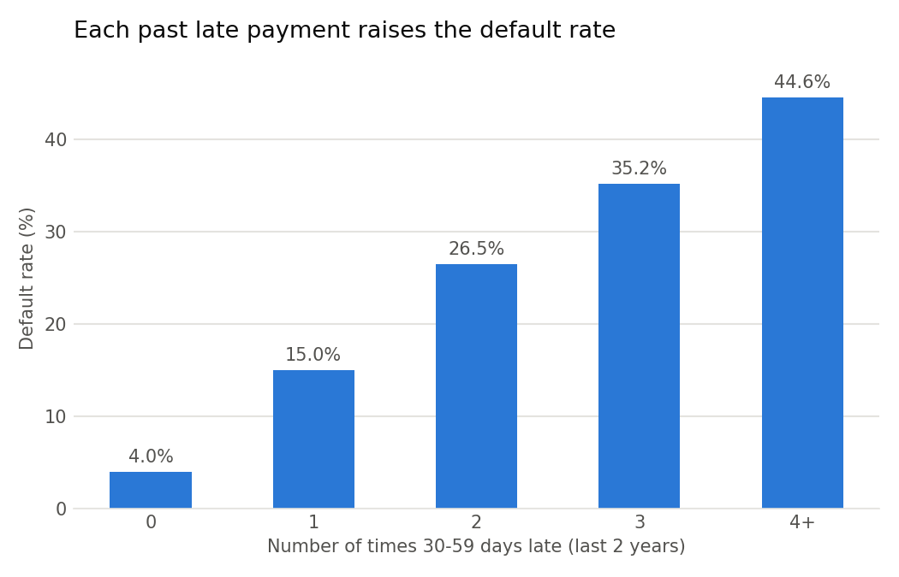
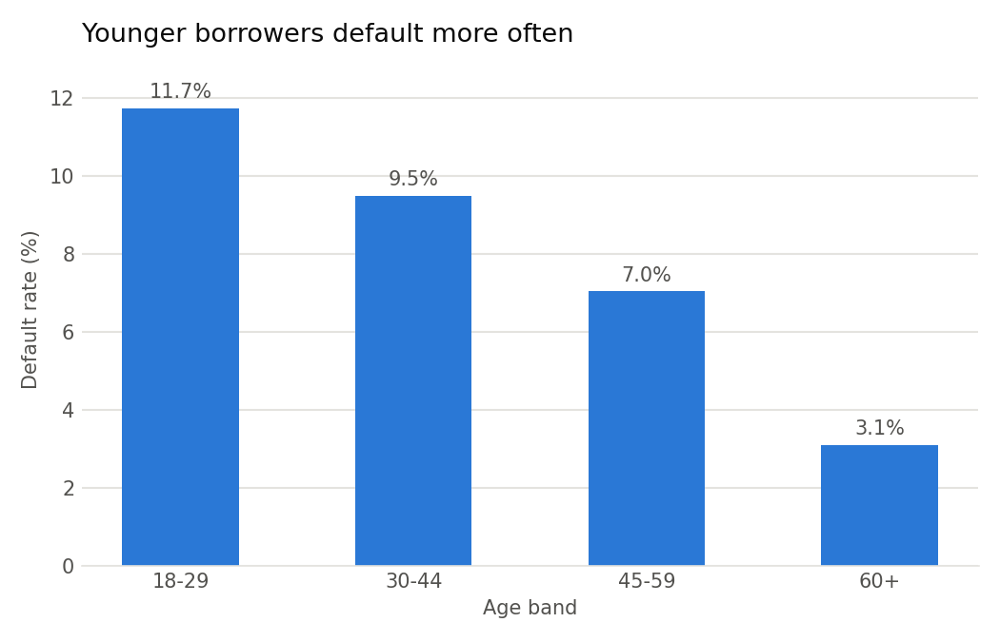

# Findings from exploring the data

These come from 149,999 borrowers in the Give Me Some Credit dataset. One row with an
impossible age of 0 was removed. Overall, 6.7% of borrowers defaulted, meaning they fell
90 or more days behind on a payment within two years.

## 1. Past late payments are the clearest warning sign

People who had never been 30–59 days late on a payment defaulted 4.0% of the time.
After just one late payment, that rate jumps to 15.0%, nearly four times higher. It keeps
rising with each late payment: 26.5% at two, 35.2% at three, and 44.6% at four or more.
How someone has handled payments before is the strongest signal we've seen so far.

## 2. Younger borrowers default more often

The default rate falls steadily with age, from 11.7% for borrowers aged 18–29 to 3.1%
for those aged 60 and over. Age helps predict risk, but lenders generally may not treat
people differently because of their age. So the model is checked for fairness across
age groups before any approval cutoff is trusted.

## 3. Missing income is not a red flag, but it distorts the debt numbers

About 1 in 5 borrowers (29,731) have no monthly income recorded. You might expect them to
be riskier. In fact, they defaulted slightly *less* often (5.6% vs 6.9%). The real problem
is in the debt ratio, which should be debt divided by income. Of the 35,137 borrowers
whose ratio is above 1, 27,904 have no income recorded. In those rows, the "ratio" looks
like a raw dollar amount of debt instead. To handle this, the model gets an extra
yes/no column that flags missing income, so it can tell these rows apart from the rest.

---

*These figures describe the full dataset. Model decisions are made on the training set
only, so the final results are measured on data the model has never seen.*
